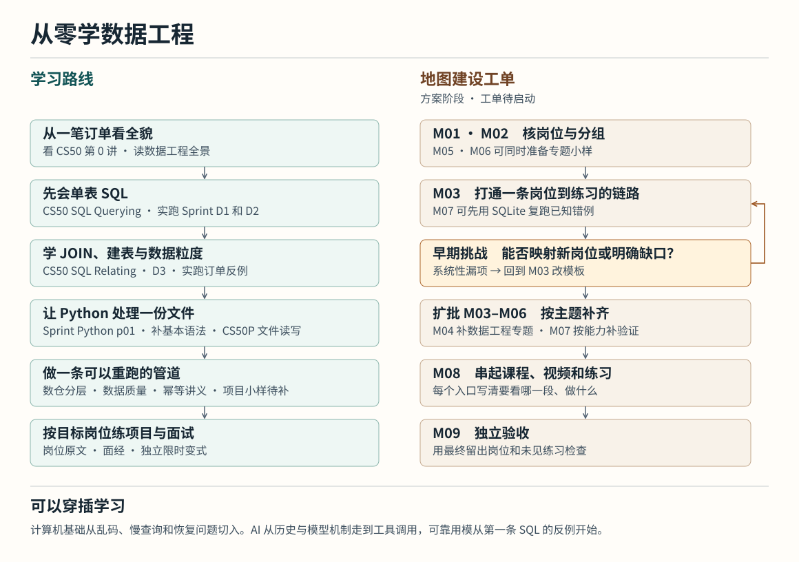

# 从零开始学数据工程

左边是学习者可以走的路线，右边是地图建设工单。沿着同一笔订单，从业务问题逐步走到数据管道。每个阶段以能做什么来判断是否往下走。右边表示计划顺序，工单尚未启动。

绘图参考：[Diagram Design 的流程图与泳道样式](https://github.com/cathrynlavery/diagram-design/tree/b228c5d77794a84150fca41b22940bb316b1398d/skills/diagram-design)。

## 每一步怎么学

| 学习阶段 | 看什么、用什么 | 自己做到什么 |
| --- | --- | --- |
| 先看数据工程在做什么 | 看 [CS50x 第 0 讲](https://cs50.harvard.edu/x/weeks/0/)关于表示数据的讲解，再读[一笔订单怎样变成报表](../notes/m0-overview.md) | 用自己的话说明订单从哪里来、谁用它、为什么不能直接从业务表抄一个数字 |
| 从一张表入手 | 看 [CS50 SQL 第 0 讲 Querying](https://cs50.harvard.edu/sql/weeks/0/)，用 [Sprint D1](../days/d01.md) 和 [D2](../days/d02.md) 在 VS Code、SQLite 中练筛选、分组和聚合。卡住时用 AI 一对一陪练 | 先手算，再运行 SQL；解释为什么 NULL、重复记录或空结果会影响指标 |
| 用多张表回答问题 | 看 [CS50 SQL 第 1 讲 Relating](https://cs50.harvard.edu/sql/weeks/1/)，练 [D3](../days/d03.md)，读[事实表与粒度](../notes/m3-02-fact-dim.md)，实跑[订单反例](order-metrics.md) | 说清每张表一行代表什么，预测 JOIN 后的行数，能用逐订单比较发现漏单和重复 |
| 用 Python 自动处理一份数据 | 从 [Sprint Python p01](../../exercises/python/p01/lesson.md)学值与类型，能写条件、循环和函数后，看 [CS50P 第 6 讲 File I/O](https://cs50.harvard.edu/python/weeks/6/)中 CSV 的部分 | 读入一份小 CSV，说明怎样处理缺失与重复，并让同一输入产生可预期的结果 |
| 做出一条管道 | 读[数仓分层](../notes/m3-01-layers.md)、[数据质量](../notes/m3-05-quality.md)和[幂等与重跑](../notes/m7-01-idempotency-rerun.md)。可先读概念和现有小样，端到端练习由 M04、M07 补齐 | 说清原始数据、明细和指标分别放在哪里。重跑一批数据后确认没有重复入库，遇到错数据能够定位 |
| 围绕目标岗位练习 | 用[岗位汇总](../../research/targets-summary.md)、[面经统计](../../research/mianjing-stats.md)和[Sprint 大纲](../syllabus.md)。根据目标岗位决定 Spark、流处理或引擎知识的学习深度 | 脱离 AI 完成一题未见变式，讲清项目的业务口径、失败边界和验证方法 |

## 可以穿插的两条路线

- **计算机基础**。有问题时回补机制。CSV 乱码回到字符编码，查询变慢回到索引和查询执行，任务失败后怎么恢复回到事务和进程。M05 会继续定位具体讲次。
- **AI 发展与可靠用模**。现在就能练“先独立写预期，再验模型生成的 SQL”。想理解历史时，从 [CS50 AI](https://cs50.harvard.edu/ai/)的搜索、推理与学习进入，再看 [Transformer 原文](https://research.google/pubs/attention-is-all-you-need/)和 [ReAct 原文](https://arxiv.org/abs/2210.03629)。M06 会补历史节点、入门解释和先修，M07 会补工具执行、错误输出和复测案例。

## 建设工单怎么认领

右列保留完整工单号。早期挑战允许回改模板，最终留出在验收前保持隔离。每项任务的输入、负责人、交付物、停止条件和依赖见[总任务书](project-plan.md)。工具和 skill 见[工作方式](workflow.md)。[Issue #3](https://github.com/johnnyzhang-eng/data-engineering-20day-sprint/issues/3)记录认领、阻塞和验收。
