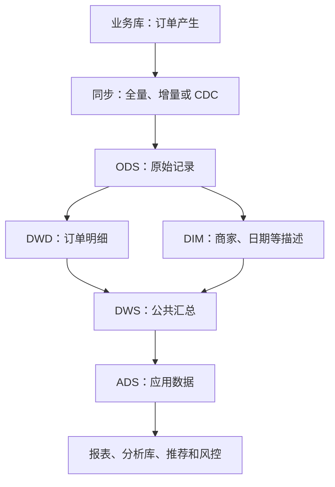

# M0 数据工程全景：一条订单怎样变成报表

## 1. 数据工程是做什么的

数据工程把分散的业务记录，变成能按时、反复、可信地使用的数据。想象一个虚构外卖平台：用户下单，商家接单，骑手送达。运营想知道“昨天哪个城市的订单取消率升高了”。这些记录有了，不等于这个问题已经能回答。

业务数据库首先服务正在发生的交易。它要让下单、付款、改状态顺利完成。分析却常要扫描几个月的数据、连接多个来源，还要追溯旧状态。直接在繁忙的业务库上这样查，可能争抢资源、拖慢交易；状态被覆盖后，也可能找不回过去。小规模分析可以从业务库开始，是否另建系统要看负载、历史和可靠性要求。

数据仓库简称数仓，是面向分析组织、整合和保存数据的体系。数据工程要把从来源到使用端的一系列处理连成数据管道，并明确出错后谁负责、怎样恢复。下面的工具只是常见例子，不代表每家公司都有同一套架构。

## 2. 一条订单数据的一生

### 产生：先把业务办成

用户提交订单，业务库记录商品、金额、状态和时间。MySQL 是业务数据库的常见例子。数据库事务让同一事务内的几项数据库写入一起提交或撤销。外部支付与订单跨系统一致性还需另行设计。这里先认识“源头”，数据库原理在 M12 讲。典型问题是状态变了，分析还沿用旧值。

### 接入：把记录送到分析侧

全量同步每次读取全部数据；增量同步只读取新增或变更的数据。按更新时间扫描是一种增量办法，但只看自增编号通常发现不了旧订单更新，也发现不了物理删除。CDC 是变更数据捕获，可通过读取数据库日志识别新增、修改和删除；它仍需要初始化、检查点（记录已处理进度）和下游正确应用变更。相关内容在 M3、M7、M13。

小表全量简单，大表反复全量会增加源库和传输压力。增量省工作量，却必须处理边界遗漏、重复、删除和补数。同步得到一份当前数据，也不自动等于保留了全部历史。

### 存储：数据放在哪里

HDFS 是把文件分散存到多台机器上的文件系统；对象存储按对象标识保存文件等内容，也是常见选择。文件内部可采用 Parquet、ORC 等列式格式，把同列的值组织在一起，分析少数列时通常可少读数据。它们是文件格式，并非数据库或计算引擎。

按日期分区，就是按日期把数据分开组织，查询时可能跳过无关部分。分得过细、写得太碎，会产生大量小文件。存储原理在 M5，小文件排查在 M4。

### 加工：把原始记录算成可用数据

SQL 是用来查询和处理关系表数据的语言。Hive 可管理表并提供 SQL 查询能力；Spark SQL 可把计算分配到多台机器。清洗状态、关联商家、按城市汇总订单，都可以用 SQL 表达。Python 是通用编程语言，可处理文件、自动化任务和辅助校验；Pandas 是 Python 中常用于表格数据处理的库。对应 M1、M2、M5、M9。

调度系统按时间与依赖启动任务，例如每天先等订单同步完成，再算昨日报表。ETL 指抽取、转换、加载，也就是取数据、整理数据、写入目标。任务失败后会重跑；幂等要求同一批输入重跑仍得到同样结果，避免重复追加。M7 讲恢复，M4 讲慢任务。JOIN 是按条件关联表，可能放大行数；Shuffle 是计算时按键（用于分组或关联的字段）重新分发数据，热点键可能让少数任务特别慢。

### 建模：规定每张表的含义

建模是先规定“一行代表什么”、字段含义及表之间的关系，再写加工逻辑。“一行代表什么”叫粒度。例如订单与订单商品行粒度不同，把订单金额复制到每个商品行后直接求和，就会重复计算。

M3 用以下常见分层组织数据。ODS 原始层保留接入记录；DWD 明细层清洗并统一业务含义；DIM 维度层提供商家、日期等描述；DWS 公共汇总层提供可复用指标；ADS 应用层服务具体看板。DIM 可被多层复用。分层是职责划分，不要求每层独占一套机器，也不是所有查询都要机械经过所有层。

存储承载图中的数据，计算和调度推动加工，质量与治理覆盖全图。

### 使用：回答问题并支持行动

报表把结果展示出来。ClickHouse 是面向分析的数据库，可承接需要快速查询的数据；它不只是报表工具，也不是数仓的必选终点，M6 再讲。推荐可使用用户和商品的特征，风控可使用异常行为指标。不同用途的时效和权限要求不同，不一定共用同一张应用表。

### 全程：保证可信且能追查

质量检查要看完整、准确、一致、及时、唯一。任务运行成功，不代表订单没漏或金额没算重。治理还要明确指标口径、负责人、访问权限与血缘。血缘就是数据来自哪里、经过哪些加工、影响哪些下游。M3、M7 讲规则和恢复，M8 要能说明自己实际做过的部分。

## 3. 批处理与流处理

批处理积累一段数据后集中计算。T+1 通常指某业务日的数据在次日约定时间可用；具体截止时间要另定。流处理持续接收并计算新事件，用于更快发现异常。实时也有延迟，要说明从哪个时点到哪个时点，以及迟到数据如何修正。

Kafka 是保存并分发事件的消息系统，帮助生产者与消费者解耦（发送方不必等待每个使用方同步完成）；Flink 是可持续处理事件流的计算框架，也支持批处理。二者不能互相替代，也不是实时系统唯一组合。实时需求不强时，批处理往往更易维护。M13 先学它们是什么。

## 4. 岗位边界

数据工程、数仓开发偏向把数据可靠地接入、加工和组织好。数据分析偏向定义问题、解释指标并提出业务判断。算法岗位偏向用数据建立预测或推荐模型。后端开发偏向支撑下单等在线业务；数据平台研发偏向构建计算、存储、调度等公共能力。实际岗位会交叉，判断职责要看交付物，不能只看名称。

## 5. 环节与模块地图

| 环节或能力 | 模块 | 要解决的问题 |
|---|---|---|
| 全程读表、加工 | M1 SQL 基础；M2 SQL 进阶 | 怎样读、关联和汇总 |
| 表的组织与历史 | M3 数仓建模 | 每行是什么，口径怎样复用 |
| 运行问题定位 | M4 场景题 | 倾斜、慢任务、小文件 |
| 存储与分布式计算 | M5 Spark / Hive / HDFS | 多机怎样存、怎么算 |
| 分析查询 | M6 ClickHouse | 怎样存表并查询 |
| 同步、加工、发布 | M7 ETL 与质量 | 失败、重复、重跑怎么办 |
| 全链路经历说明 | M8 项目防守 | 做过什么，证据在哪里 |
| 文件处理与自动化 | M9 Python 与 Pandas | 怎样用程序处理数据 |
| 编程基础 | M10 算法 | 怎样分析步骤与计算成本 |
| 沟通协作 | M11 行为面 | 怎样说明选择与责任 |
| 数据产生端 | M12 数据库原理 | 事务、索引怎样工作 |
| 变更与事件流 | M13 CDC / Kafka / Flink | 先分清各自作用 |

已有统计的 37 篇正式样本中，SQL 为 30/37，数仓建模为 27/37，场景设计为 31/37，项目深挖为 35/37。这是收集样本的篇级频率，不能当成所有面试的概率，题型也不能相加。依据见 `research/mianjing-stats.md` 与 `docs/syllabus.md`。

## 6. 为什么按这个顺序学

按任务清单：10/30 先看全景；D1–D2 学 M1，才能读后续示例。D2–D6 下午并行学 M3，解释表为什么这样建；D3–D7 学 M2。D3 上午的 JOIN 放大与下午的粒度是同一问题的两面。

过了 D3 门槛，D4 起每天少量加入 Python，避免两门语言同时从零开始。D6 看 ClickHouse，把模型放进具体数据库。D8–D9 学 M5，再于 D9 学 M7，才能理解数据流动出错后怎样恢复。D10–D11 学场景题，因为判断倾斜先要理解 Shuffle。

D11–D13 再补算法、数据库原理和 CDC/Kafka/Flink；D14 学行为面。项目防守贯穿全程，每学一块就回到实际经历讲一遍。每个知识点都问：为什么存在、解决什么问题、怎么做、什么时候不适用。

## 7. 二十个核心词汇

| 词 | 一句话解释 | 详学模块 |
|---|---|---|
| 数据管道 | 从来源到使用端的一系列处理 | M7、M8 |
| 业务库 | 优先支持在线业务操作的数据库 | M12、M3 |
| 数仓 | 为分析整合和组织数据的体系 | M3 |
| SQL | 查询和处理关系表数据的语言 | M1、M2 |
| 全量同步 | 每次读取全部源数据 | M3 |
| 增量同步 | 读取新增或变更的数据 | M3、M7 |
| CDC | 捕获数据变化的机制 | M13 |
| HDFS | 将文件分散存到多机的文件系统 | M5 |
| 对象存储 | 按对象标识保存和访问内容 | M5 中作存储对照 |
| 列式文件 | 把同列值组织在一起的文件格式 | M5 |
| 调度 | 按时间与依赖启动任务 | M7 中结合重跑 |
| ETL | 抽取、转换和加载数据 | M7 |
| 粒度 | 一行数据代表什么 | M3 |
| 事实表 | 记录业务过程及其度量的表 | M3 |
| 维度表 | 描述业务对象和观察角度的表 | M3 |
| ODS | 尽量保留接入原貌的原始层 | M3 |
| DWD | 统一业务含义的明细层 | M3 |
| DIM | 公共维度层 | M3 |
| DWS | 可复用的公共汇总层 | M3 |
| ADS | 面向具体应用的数据层 | M3 |

## 8. 原理自测

先不回看正文，大声讲；对照要点只在离线 HTML 的折叠中。

1. 为什么有了订单业务库，还可能需要数仓？什么条件下可以先不另建？
2. 按自增编号做增量，为什么可能漏掉旧订单的变化？CDC 又是否自动解决全部同步问题？
3. ODS、DWD、DIM、DWS、ADS 分别承担什么职责？为什么不直接让每张报表各算一遍？
4. T+1 与实时的主要区别是什么？Kafka 与 Flink 分别做什么？
5. 为什么任务成功还要检查质量？为什么学倾斜之前先学 Shuffle？
