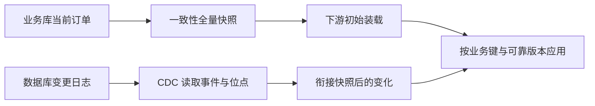
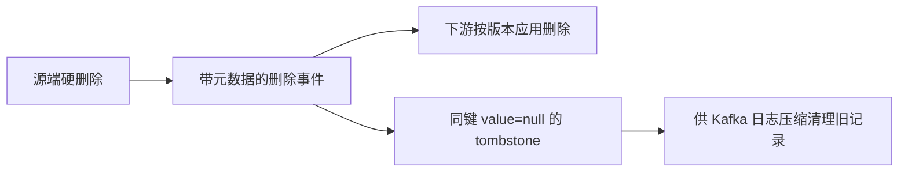

# M13：快照与 CDC——变化怎样完整传到下游

> 订单从业务库进入数仓时，可以定期复制整表，也可以持续读取增、改、删事件。本讲位于“获取”环节，核心问题是：初装怎么做、变化会不会漏、删除能不能被看见。
>
> 对应原理：**全量给起点，增量接变化**、**恢复位置要有依据**、**只传增改会漏硬删除，全量替换或快照差分也能同步删除**。

## 1. 全量快照与增量同步各解决什么

全量快照是在某个一致性边界复制表内容；一致性边界指整份数据来自同一时点或同一事务视图，避免把不同时刻的行拼成不存在的状态。它适合初始化、周期重建或小表同步，但大表复制成本高，两次快照之间的中间变化也无法从最终结果还原。

增量同步只传变化。按更新时间扫表容易实现，却依赖时间字段完整、时钟与精度可靠，也通常看不到硬删除。CDC（Change Data Capture，变更数据捕获）在本讲特指日志型 CDC：从数据库日志读取插入、更新、删除及位点。位点是日志中的可恢复位置，例如 binlog 文件名、文件内位置及事件内行号，而不是当前墙上时间。

日志型 CDC 仍需处理快照衔接、重复投递、结构变更和下游幂等。结构变更指增删列、修改类型等，会影响旧事件的解析；下游幂等指同一事件重放一次或多次，最终业务结果相同。业务键标识同一个实体，如订单号；版本区分该实体更新的先后，不能假定秒级更新时间总能给出严格次序。

## 2. 快照接 CDC，最怕缝里有洞

快照读取期间源库仍可能变化，必须由数据库与连接器协议确定快照对应的日志位置，再从该位置接续变化。重叠事件可幂等应用；漏掉一段则不能指望“后来又没变化”自动修复。

初始化是一条有边界的协议：确定一致性快照与日志位点 → 装载 → 从位点读取 → 处理重复 → 校验连续性。具体位点与锁、事务视图的配合以连接器为准；不能拿任务结束时的当前时间代替日志位置，也不能把普通分区替换等同于已实现这种衔接。

## 3. 高水位与回看窗口不是万能保险

高水位记录“上次处理到哪里”，可按日志位点或更新时间与业务键的组合表达。只存最大更新时间有风险：同一时刻多条记录若只处理一部分，下次从严格大于该时间开始就会漏；改用“大于等于”会重叠，所以下游仍需去重。

回看窗口覆盖的是可接受的延迟，不证明更早记录永远不会到；长期补偿还需审计、补数或周期性对账。对 CDC 而言，持久化位点应在下游结果可靠落地后再推进，否则崩溃可能把未写事件标成已消费；先落地后推进则须能安全重放。

## 4. 删除事件、软删除与 tombstone 要分清

硬删除把源行移除，按更新时间扫表再也扫不到它；若日志读取只订阅增改，也会让下游旧行残留。只读审计可以发现差异，不能自动修复。同步删除有两条常见路径：传播并应用删除事件；或取得一致性完整快照，真正替换目标范围、或用快照差分对账删除目标多出的键。仅重插源端现存行不能清除目标旧行。

- **业务软删除**：保留源行，用 `is_deleted` 等字段表示失效，下游按约定过滤或保留历史。
- **删除事件（delete event）**：记录某个键已被删除及相应元数据。Debezium MySQL 的 `op=d` 事件包含删除前的行和 source 中的日志位置等信息，供下游应用删除。
- **tombstone**：在这里专指 Debezium/Kafka 语境中，同一个键、`value=null` 的特殊记录。Debezium 默认在删除事件后发送它，让 Kafka 日志压缩最终清理该键的旧记录；它的 value 不携带删除前行、版本或位点。日志压缩是按键清理旧日志记录的存储机制，不会自动删除外部结果表。

删除也要遵守版本与重放规则：旧更新若在删除后迟到，不能让已删除订单重新出现。修复漏删既可补齐事件捕获与下游应用，也可按业务时效采用周期性替换或差分对账；选择哪条路径，要核对删除传播延迟、成本与历史需求。

## 读原文

只读下面一份资料的指定小节，不通读配置清单。先回答“硬删除后，按更新时间扫表为什么看不见”；记录版本与位置，25 分钟到点或单段卡住 10 分钟就带问题停下。本篇 25 分钟，加下一篇 20 分钟，M13 原文阅读合计不超过 45 分钟。

| 资料与小节 | 带着什么问题读 | 用时 |
|---|---|---:|
| [Debezium MySQL Connector 3.7](https://debezium.io/documentation/reference/3.7/connectors/mysql.html)：Snapshots 中初始快照流程、delete events、Tombstone events | 快照怎样接日志？删除事件与同键空值记录有什么不同？ | 25 分钟 |

## 口述追问

1. 每天做全量快照，是否就不需要 CDC？
2. 高水位保存最大更新时间，为什么仍可能漏数据？
3. 已经发现 ODS 旧行因源端硬删除而残留，只补跑一次全量够吗？
4. 同一订单先删除、后收到延迟的旧更新，只按业务键覆盖会怎样？删除事件与 tombstone 各能提供什么帮助？
5. 快照装载期间源端持续增改删，为什么不能用任务结束时间接增量？若改用周期性完整替换，又要满足哪些一致性和时效条件？
