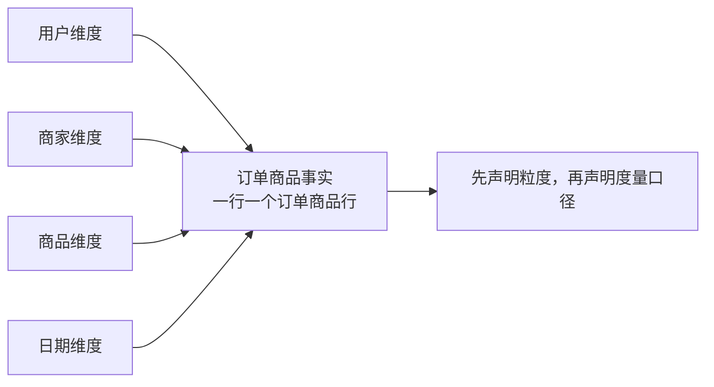

# M3-02 事实表、维度表、粒度与三类事实表

## 1. 事实与维度：事件和观察角度

事实表回答“发生了什么”，通常包含外键、时间以及可度量的数字；维度表回答“从谁、何地、何物、何时等角度看”，保存这些对象的描述。外卖订单中，商品数量、优惠金额、配送费是事实；商家品类、用户所在城市、商品规格是维度属性。

区分它们不能只靠字段类型。金额也会出现在维度表的“定价参考”中，名称也可能被事实表做快照保留。判断关键是：**这张表在描述一个业务过程，还是在描述观察业务过程的对象？**

度量还要区分可加性。订单金额可跨商家、日期相加；账户余额可跨账户相加，却不能直接跨日期相加，否则同一笔余额被重复计算；比率通常应先分别汇总分子和分母，再相除，而不是直接平均各行比率。建模时明确可加性，才能避免“SQL 没报错，业务却算错”。

## 2. 为什么先声明粒度

粒度就是“一行代表什么”。建表前写出这句话，并同时明确业务主键。例如：

> `fact_order_item` 一行代表一个订单中的一件商品，业务主键为订单号与订单商品行号。

粒度决定一行何时产生、哪些字段能放在表中、指标如何汇总以及能与谁安全关联。若把“一单一行”的配送费原样复制到三条商品明细上，再对整表求和，配送费就被算三次。类似地，订单表与支付流水表直接连接，一单多次支付会复制订单金额，多次退款又可能进一步放大行数。

解决办法不是盲目 `DISTINCT`，而是让连接两侧粒度一致：先把支付流水聚合成一单一行，或把订单金额与支付金额分别统计后再连接。`DISTINCT` 可能掩盖重复原因，还会把本该同时存在的两条真实明细删掉。

## 3. 三类事实表

### 事务事实表

一行记录一次不可再拆的业务事件，如一次下单、一次支付或一次配送完成。事件发生后通常追加新行，适合分析事件数量、金额及明细构成。它最贴近原始行为，但回答“每天结束时还有多少待配送订单”需要重放事件，成本较高。

### 周期快照事实表

按固定周期对同一对象保存状态，例如“一行代表某商家某营业日结束时的经营状态”，记录当日订单量、期末可售商品数、期末评分。即使当天没有变化，也可按业务需要保留一行。它适合比较周期性状态和半可加度量，但要预先确定快照时点与时区；不同时点的余额或库存不能直接比较。

### 累积快照事实表

一行跟踪一个业务实体的完整生命周期，并在到达里程碑时更新。例如“一行代表一笔配送订单”，保存下单、支付、商家接单、骑手取餐、送达等时间，以及当前结果。它适合计算各环节耗时和漏斗转化；与事务事实表相比，它不是保存每次变化，而是不断更新同一生命周期行。取消、改派、重复事件等分支也必须定义清楚。

| 类型 | 一行代表 | 行的变化 | 适合回答 |
|---|---|---|---|
| 事务事实 | 一次业务事件 | 通常追加 | 发生了什么、发生多少 |
| 周期快照 | 某对象在某周期末的状态 | 周期性新增 | 各时点状态如何变化 |
| 累积快照 | 一个实体的生命周期 | 随里程碑更新 | 流程走到哪、每段多久 |

## 4. 如何选择

先写分析问题，再选表。研究“每笔优惠由哪些商品分摊”需要订单商品事务事实；研究“每天期末可售商品数”需要周期快照；研究“接单到取餐的耗时”需要累积快照。三者可以并存，因为它们不是同一数据的三种格式，而是三种不同的观察方式。

最后检查度量与粒度是否匹配：订单级指标放订单表，商品行级指标放商品明细表；确需跨层使用时，要么明确分摊规则，要么在查询中先聚合。先声明粒度，实质是先规定这张表对世界作出的承诺。

可以把这个承诺写成一张设计卡：表名、粒度、业务主键、事件时间、度量及可加性、维度外键、迟到数据处理方式。随后用两个极端样例验收：一笔订单只有一件商品，以及一笔订单有多件商品、多次支付和一次取消。若同一张表无法在不复制金额的情况下表达两个样例，通常说明粒度或事实类型尚未选清，而不是继续补 SQL 技巧。

## 口述追问

1. 订单号既有业务含义又能标识订单，为什么它可能出现在事实表而不是独立维度表？
2. 一单有多件商品且有多笔支付时，如何同时计算订单金额和支付金额而不放大？
3. 账户余额为什么通常不能跨天求和？如果业务坚持要一个“余额总量”，怎样定义才有意义？
4. 累积快照可以记录送达时间，是否意味着事务事实表不再需要？分别会失去什么能力？
5. 周期快照某天漏跑，次日直接补一行会有什么风险？需要同时补齐哪些口径信息？
