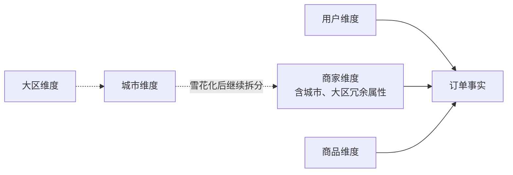

# M3-03 星型、雪花、主题域与退化维度

## 1. 星型与雪花的差别

维度建模把事实表放在中心，把用户、商家、商品、日期等维度放在周围，形成星型模型。星型的维度表通常是宽表：商家维度里同时保存商家名称、品类、城市、大区。不同商家会重复相同的城市和大区名称，因此它有意保留冗余。

雪花模型进一步规范化这些属性：商家表只保留城市键，城市表保存城市名并关联大区键，大区表再保存大区名。重复减少、属性归属更集中，但查询需要更多 JOIN。

数仓通常偏好星型，并非冗余天然正确，而是分析查询常要扫描大量事实再按多个维度过滤、分组。星型结构更直观，JOIN 链更短，优化器更容易处理，业务人员也更容易得到一致口径。宽维度表的存储成本，往往小于反复关联和错误使用模型的成本。

雪花也不是错误选择。当层级属性维护复杂、维度很大、上层属性变化频繁，或多个下游必须严格复用标准层级时，规范化更有价值。选择应比较查询模式、维护成本和团队口径，而不是把“星型先进、雪花落后”当结论。

## 2. 主题域怎样划分

主题域是围绕稳定业务对象或业务过程组织数据的边界，例如交易、履约、用户、商家。它不是按源系统划，也不是按当前部门或报表划：源系统会替换，部门会调整，报表会不断增加，而“下单”“配送”这些业务过程相对稳定。

划分的实际作用，是明确数据资产归属、公共维度和指标复用范围。交易域可以拥有订单与支付事实，履约域拥有接单、取餐、送达等事实；两个域都复用一致的商家、用户、日期维度。若各域各自定义“有效商家”，跨域分析就会失去共同语言。

一个新指标归哪个域，要看它描述的**业务过程和粒度**，而不是看提出需求的团队。例如“商家日均配送时长”虽然展示在商家报表，核心事件却来自履约过程；可由履约域提供公共指标，商家相关应用再消费。主题域边界不要求事实之间毫无关系，而要求关系通过明确的键和公共维度表达。

## 3. 什么是退化维度

订单号是一个观察维度：可以按它追踪、去重和关联，但如果除了订单号本身，所有订单属性都已经存在于事实表或其他维度中，再建一张只有订单号的巨大维度表几乎没有收益。这时把订单号直接留在事实表，称为**退化维度**。

它“退化”的不是业务价值，而是独立维度表的存在形式。订单号仍能作为分析入口，只是没有一组额外属性需要维护。常见场景还包括支付流水号、配送单号，但是否退化必须看实际模型：若配送单另有独立类型、承运商等属性，就可能需要正式维度。

退化维度也解决高基数问题。订单号几乎与事实行同量级，为其建立一对一维度表会增加存储与 JOIN，却不增加描述能力。但不要把所有编号都当退化维度：商家编号背后有名称、品类、城市等丰富属性，显然属于商家维度。

## 4. 一次完整建模判断

为外卖订单设计模型时，先确定订单事实的粒度，再识别用户、商家、商品、日期等公共维度。默认让维度以宽表呈星型，只有当城市层级需要独立治理时再局部雪花化。订单号保留在事实表作为退化维度。最后按交易、履约等业务过程确定事实归属，而不是把所有表塞进“订单域”。

这四个决定相互约束：粒度不稳，星型关联会放大；主题域不清，公共维度会分叉；雪花拆分过度，口径路径会变复杂；误删退化维度，又会失去按业务单号追踪的能力。模型的好坏体现在这些取舍能否解释，而非图是否漂亮。

还要警惕两种伪复用。其一是为了少建表，把不同粒度的事实强塞进同一张宽表；其二是为了表面统一，把含义相近但口径不同的对象合成一个维度。例如“下单用户”和“收货用户”可能是不同角色，应通过角色扮演维度或明确外键区分。真正复用的是稳定语义，不是表数量最少；真正简洁也不是关联最少，而是每个业务概念只有清楚的位置。

## 口述追问

1. 星型模型减少 JOIN 就一定更快吗？什么条件下冗余宽表反而可能成为问题？
2. 如果城市更名，星型和雪花分别要改哪些数据？怎样避免历史订单被意外改写？
3. 两个主题域都需要“活跃商家”，应各自计算还是共用？共用时最先统一什么？
4. 订单号高基数所以做成退化维度，这个理由是否充分？还要检查哪些属性？
5. 新需求要求按商家集团分析，你会把集团字段塞进商家维度，还是雪花化？给出取舍条件。
