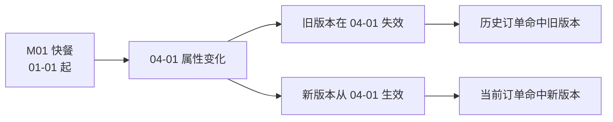

# M3-04 缓慢变化维、拉链表与同步方式

## 1. 维度为什么会“缓慢变化”

订单事实不断新增，而商家名称、品类、所属城市、用户等级等维度属性通常变化较少，却会随时间改变。分析历史订单时，究竟使用商家现在的品类，还是下单时的品类？这就是缓慢变化维（SCD）要解决的问题。真正需要选择的不是“覆盖还是新增”这句口诀，而是**业务要求保留多少历史语义**。

- **SCD1：覆盖旧值**。商家修正错别字后直接更新名称，不保留旧值。实现简单，适合不关心历史或旧值属于错误的场景；代价是历史查询全部按新值解释。
- **SCD2：新增版本**。属性变化时增加一行，用生效与失效时间区分版本，可完整还原历史。代价是维度行数增加，事实与维度关联必须考虑时间或代理键。
- **SCD3：有限历史**。在当前值旁增加“前一个值”等字段，只保留有限次变化。查询方便，但再变一次就会丢失更早历史，适合只看前值与现值的固定需求。

例如商家从“快餐”调整为“轻食”。若只是分类纠错，SCD1 合理；若要研究调整前后订单结构，SCD2 合理；若页面只需显示“原品类／现品类”，SCD3 已足够。类型由问题决定，不由工具决定。

## 2. 拉链表如何实现 SCD2

拉链表用开始日期和结束日期描述版本有效区间。推荐采用左闭右开区间 `[start_date, end_date)`：开始日期包含，结束日期不包含。当前版本可用一个约定的远期日期表示，也可用空结束标记，但全表必须统一。

| merchant_id | category | start_date | end_date |
|---|---|---|---|
| M01 | 快餐 | 2026-01-01 | 2026-04-01 |
| M01 | 轻食 | 2026-04-01 | 9999-12-31 |



查询 2026-03-15 的商家状态：

```sql
SELECT merchant_id, category
FROM dim_merchant_zipper
WHERE merchant_id = 'M01'
  AND start_date <= DATE '2026-03-15'
  AND DATE '2026-03-15' < end_date;
```

查当前状态只需把日期换成业务当前日期，或按统一约定筛选当前版本。发生变更时，同一批次应关闭旧版本并开启新版本，保证区间不重叠、无空洞。若事实表直接保存对应版本的代理键，历史关联更简单；若只保存自然键，就要按事件发生时间做时点关联，不能拿当前维度直接解释全部历史。

拉链表比每天保存全量维度快照省空间，是因为未变化的行无需每日复制，只在变化时增加版本。若维度每天大面积变化，版本会接近全量快照，拉链优势下降，查询维护成本却仍在，因此它不是所有历史表的默认答案。

## 3. 全量与增量同步

**全量同步**每次读取源表全部数据。逻辑简单，容易发现源端差异，适合小表或定期校准；代价是读取、传输和重写成本高，源端删除若只靠简单追加也无法自动反映。

**增量同步**只读取变化记录，常见识别方式有：

1. **更新时间**：读取水位线之后的记录，但要处理同一时刻多条、跨区时间、迟到更新和时钟偏差。常用重叠窗口加去重，而不是把边界卡得毫无余量。
2. **自增 ID**：适合只追加的新记录，但仅靠它发现不了旧行修改和删除。
3. **CDC**：读取数据库变更日志，可捕获插入、更新和删除，更接近完整变化流；同时要处理日志位点、顺序、重复投递和结构变更。

源头删除必须先区分业务删除、软删除和物理删除。软删除可同步删除标志与时间；CDC 可传递物理删除事件；扫描式增量往往察觉不到已经消失的行，需要源端删除日志、定期全量对账或其他补偿机制。增量不是“今天新增多少行”这么简单，而是完整识别增、改、删。

实际方案常是增量承担日常效率，全量承担初始化与周期校验。无论哪种方式，批次都应可重跑：用稳定业务键去重、按分区覆盖或依据位点幂等消费，避免重试把同一变化重复写入。

这里还要分清三种时间：业务真正生效的时间、源系统记录修改的时间、数仓接收数据的时间。维度历史应优先按业务生效时间解释，增量水位线通常依据源修改或日志位点推进，延迟监控则关注接收时间。混用三者会出现“数据已经同步，却被放进错误历史区间”的问题。补录一条过去生效的变更时，还可能需要拆分或调整既有版本，而不能只把它追加到当前末尾。

## 口述追问

1. SCD2 能保存历史，为什么还需要代理键或事件时间？只用商家编号会发生什么？
2. 拉链表用左闭右开区间有什么好处？如果两端都包含，查询和更新要额外防什么？
3. 商家属性每天频繁变化时，拉链表仍一定优于每日快照吗？如何判断？
4. 按更新时间做增量，昨晚一条迟到记录没有进入今日窗口，怎样补救并保证不重复？
5. 源库物理删除一行，自增 ID 和更新时间为什么都可能发现不了？可设计哪些补偿机制？
