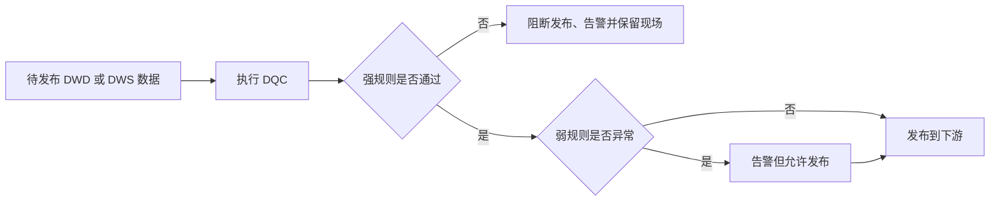

# M3-05 数仓质量、DQC 与阻断策略

## 1. 数仓质量不是一个“准确率”

数仓质量要回答的是：数据是否足以支持约定用途。常见评价维度包括完整性、准确性、一致性、及时性和唯一性。它们相互关联，但不能互相替代。

- **完整性**：应有数据是否齐全，如某营业日订单分区是否存在、关键字段是否缺失。
- **准确性**：值是否接近真实业务，如订单实付是否与支付记录一致。字段非空不代表金额正确。
- **一致性**：同一对象在不同表、层和系统中的含义是否一致，如 ODS 与 DWD 的状态映射后订单数是否吻合，两个看板的销售额是否同口径。
- **及时性**：数据是否在承诺时间前可用，如每日看板要求 8:00 就绪，正确但 10:00 才产出仍未达标。
- **唯一性**：应唯一的业务键是否重复，如同一订单商品行是否出现两次。

还可增加有效性，如状态必须在枚举内、金额不能违反约定范围。质量指标必须绑定对象、粒度、统计窗口与阈值；“质量很高”不是可执行定义，“每日 8:00 前，订单分区订单号重复率为 0”才是。

## 2. DQC 常见规则

数据质量校验（DQC）应覆盖技术结构、业务语义和上下游关系，而不只看行数。

1. **非空与完整率**：订单号、发生时间等关键字段非空；必要来源和分区齐全。
2. **唯一性**：按声明的业务主键分组，检查重复数。主键本身来自粒度，粒度错了，唯一性规则也会跟着错。
3. **枚举、范围与格式**：订单状态属于允许集合，数量大于零，时间格式和时区符合约定。范围规则要给真实业务例外留出口，而非凭感觉设阈值。
4. **引用完整性**：订单事实的商家键应能关联到有效商家维度；若允许历史商家或迟到维度，应明确例外和补数流程。
5. **行数与分布波动**：与昨日、上周同日或滚动基线比较。突增可能是业务活动，突降可能是漏数，所以波动通常需要结合上下文判断。
6. **上下游对账**：比较源端与 ODS、DWD 与 DWS 的行数、金额、状态分布或聚合值。对账要统一过滤条件、时间窗口和口径，否则差异可能来自规则而非故障。
7. **新鲜度**：检查最大事件时间、分区到达时间与任务完成时间，防止任务“成功”却一直更新旧数据。

## 3. 强规则阻断，弱规则告警

**强规则**用于失败后果严重且判断明确的条件，如目标分区为空、业务主键重复、关键字段大面积缺失、上下游金额出现无法解释的重大差异。失败后应阻断发布，避免错误继续传播到 DWS、ADS 和数据产品。

**弱规则**用于值得调查但未必是故障的条件，如订单量较昨日波动 30%。促销、节假日和恶劣天气都可能造成真实波动，直接阻断会让正常业务无法上线。弱规则可以告警、记录并进入人工复核。

强弱不是按 SQL 好写程度划分，而由**业务影响、规则确定性和可恢复性**决定。同一规则也可能随场景改变：测试环境只告警，核心资产生产区阻断；小幅波动告警，接近全量丢失则升级为阻断。

阻断最好针对“发布”而不是粗暴删除现场。任务可先写临时表或临时分区，校验通过后再原子发布；失败时保留上一版可用数据、异常样本、批次号与规则结果。这样既避免下游读到半批数据，也能让工程人员复查原因。

## 4. 从规则走向质量体系

规则上线后仍需治理：为每条规则配置负责人、阈值依据、严重级别、通知对象和处理时限；记录告警是否真实故障，持续调整误报与漏报。只追求“告警多”会让团队麻木，只追求“任务全绿”又可能把问题藏起来。

质量评价还要分层。ODS 更关注接入完整和及时，DWD 更关注主键、清洗和业务准确性，DWS／ADS 更关注指标口径与对账。最终目标不是所有表都达到同一组静态指标，而是让关键数据在约定时间内可信，并且出错时能发现、能定位、能恢复。

阈值也需要验证。新规则可先只观察一段时间，比较异常时的真实业务结果，再决定告警或阻断；季节性强的指标应使用同星期、同活动周期的基线。漏报和误报都要复盘：误报多会消耗信任，漏报则说明规则没有覆盖关键风险。规则本身也是代码，应有版本、变更记录和测试样例，避免修改阈值后无法解释历史结果。

## 口述追问

1. 任务成功且行数与昨天一致，为什么仍不能说明数据质量正常？还能检查什么？
2. 主键唯一性规则为什么依赖粒度？举出一个“重复行其实合法”的例子。
3. 上下游金额对账不一致，如何区分真实数据错误和统计口径不同？
4. 行数突降 40% 应该是强规则还是弱规则？什么信息会让你调整级别？
5. 强规则失败后为什么应阻断发布而不是直接清空异常表？怎样兼顾下游可用性与现场排查？
