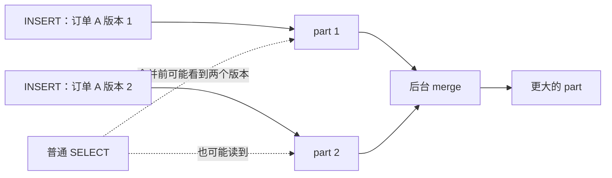
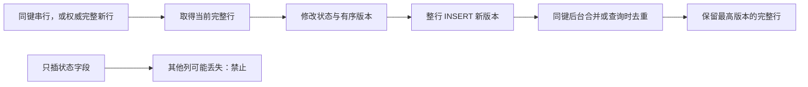

# M6：ClickHouse MergeTree——排序、合并与去重各管什么

> 订单进入分析层后，需要频繁按条件扫描、聚合。ClickHouse 位于“分析存储与服务”环节；表引擎决定表怎样存储数据、怎样在后台处理数据。理解它，关键是分清数据怎样摆、何时合并、查询何时去重。
>
> 对应原理：**按访问方式组织数据**、**后台合并不保证去重完成**、**正确性与查询成本要一起算**。

## 1. 列式 OLAP 与 part

OLAP 面向分析查询：常读许多行、少数列并做聚合。列存把同一列连续存放，只读所需列，也利于压缩；这不意味着所有点查、单行更新都天然更快。

MergeTree 插入会形成数据片段 part，后台再异步合并。逻辑键是标识同一业务对象的字段组合，例如订单号。ReplacingMergeTree 中，同一逻辑键的多个版本可以同时存在，后台合并**不保证所有重复最终都会消失**；需要当前正确结果时，仍须查询时去重。普通 MergeTree 合并本身并不按键去重。[ReplacingMergeTree 官方说明](https://clickhouse.com/docs/reference/engines/table-engines/mergetree-family/replacingmergetree)。

## 2. 分区、排序键、稀疏主键索引不是一回事

`PARTITION BY` 决定数据属于哪个逻辑分区，便于按分区管理和裁剪。查询带分区条件时，系统可跳过无关分区；**分区裁剪只负责跳过无关分区，不等同于主键索引**，进入分区后仍要靠排序与索引进一步缩小读取。

`ORDER BY` 决定数据在磁盘上的排序键。未另设 `PRIMARY KEY` 时，它也决定稀疏主键索引的键。granule 是按排序顺序排列的一组连续行，也是读取数据的基本粒度，常见上限为 8192 行，实际大小还受表设置与字节数限制。索引通常记录每个 granule 的首个键值，因此能跳过不可能匹配的 granule，而不是为每一行保存地址。排序键前缀是复合键从左起的连续几列，例如 `(日期, 订单号)` 的“日期”；查询利用前缀通常更容易缩小读取范围，只按后面的列过滤收益可能有限。

对 ReplacingMergeTree 而言，**`ORDER BY` 同时决定排序键与去重键**。键越宽，被认定为“同一对象”的范围越窄，索引与排序维护成本也越高，**宽键不是无成本**。设计时要先声明“一行代表什么”，不能为了点查把更多列随意塞进键里。

## 3. ReplacingMergeTree：更新其实是新版本整行

`ReplacingMergeTree(updated_at)` 在合并涉及的行中，对相同 `ORDER BY` 键保留版本列最大的一行。若省略版本列，或最大版本并列，则按参与合并的数据中最近插入的行取舍；写入先后不一定等于业务更新先后，设计中应使用能表达更新顺序的版本。

更新一个字段时，可以整行重插，但**同一个键的更新必须串行，或有权威的完整新行来源**，并提供正确反映源端先后的版本。串行读改写须在同键协调下读取最新整行、修改字段、写入更高版本；有权威完整新行时，则直接写入源端更新后的完整内容。否则两人各自读到旧行，一个改支付状态，一个改地址，后者的新整行可能把前者的支付状态覆盖回去；提高时间精度不能替代并发协调。**不能拿半行补字段**，否则未提供的列可能变成空值或默认值，并被当成最新完整版本保留下来。还应保证同一键的新旧版本进入同一分区，否则不能指望分区内去重消除跨分区重复。

## 4. FINAL、argMax、GROUP BY 怎样选

普通查询在合并前可能看到重复。`FINAL` 在查询时执行去重，能得到 ReplacingMergeTree 的最新版本语义，但**`FINAL` 有查询代价**：要读取并合并相关数据，过滤条件不佳时成本更高，不能到处自动添加。

`argMax(col, version)` 取最高版本对应的值，配合按完整逻辑键 `GROUP BY` 使用。也可以用 `argMax(tuple(status, amount), version)` 一次选取同一行的多列；tuple（元组）就是把多个值捆成一个整体。元组内某列为 NULL 时，不会因为该列为空就单独改取旧版本。最大版本并列时，argMax 不保证选择哪一行；可用有业务依据的 `(version, sequence)` 作为比较值，sequence 是源端提供的次序号，不能临时随意编造。[argMax 官方说明](https://clickhouse.com/docs/reference/functions/aggregate-functions/argMax)。

`GROUP BY` 或 `DISTINCT` 适合只需键集合的场景；若需要同一版本的一整行，对各列分别取最大值可能拼出从未存在过的组合。FINAL 需要读时合并，argMax/GROUP BY 需要扫描并维护各键的聚合状态，键很多时会消耗内存；选择应从所需结果集反推。

### 四行外卖数据：读到的版本为何不同

以下全是虚构订单，表用 `ReplacingMergeTree(version)`、`ORDER BY order_id`，同键均落在同一分区，版本不并列。

| 订单号 | 状态 | 实付元 | version |
|---|---|---:|---:|
| A | 待支付 | 0 | 1 |
| A | 已支付 | 28 | 2 |
| B | 已支付 | 35 | 1 |
| B | 已退款 | 0 | 2 |

| 读取方式／时点 | A 的结果（状态，实付元，版本） | B 的结果（状态，实付元，版本） | 行数 |
|---|---|---|---:|
| 合并前，普通读取 | 待支付，0，1；已支付，28，2 | 已支付，35，1；已退款，0，2 | 4 |
| 假设一次合并已覆盖全部上述版本，普通读取 | 已支付，28，2 | 已退款，0，2 | 2 |
| 合并前使用 FINAL | 已支付，28，2 | 已退款，0，2 | 2 |
| 合并前按订单号分组，用 argMax 取状态、实付及版本组成的元组 | 已支付，28，2 | 已退款，0，2 | 2 |

对照表按上述规则推演，不是后台合并完成时间的承诺。若只按订单号分组，拿到的是 A、B 两个键；还不能据此知道它们的最新状态。若 B 又收到不同内容的版本 2，FINAL 的插入次序规则与 argMax 的并列取舍可能不同，须先解决版本冲突，不能宣称两种查询总等价。

## 读原文

先写下“分区、排序键、版本列各负责什么”的读前答案；读时记录小节与页面版本，卡住 10 分钟就带问题停下。

| 资料与小节 | 带着什么问题读 | 用时 |
|---|---|---:|
| [ClickHouse MergeTree](https://clickhouse.com/docs/engines/table-engines/mergetree-family/mergetree)：ORDER BY、PARTITION BY、PRIMARY KEY、Data storage | part 何时产生？排序与分区怎样分别缩小读取？ | 25 分钟 |
| [ClickHouse Primary Indexes](https://clickhouse.com/docs/primary-indexes)：稀疏主索引与 granule | 为什么不为每行建索引也能跳过数据？ | 15 分钟 |
| [ClickHouse ReplacingMergeTree 指南](https://clickhouse.com/docs/zh/guides/replacing-merge-tree)：去重、version、FINAL | 为什么普通查询会重复？FINAL 换来了什么、付出了什么？ | 20 分钟 |

## 口述追问

1. ReplacingMergeTree 已经会去重，为什么查询还要 FINAL？
2. 把更新时间放进 ORDER BY，能否让每个版本都保留？
3. 只把订单状态从“待支付”改为“已支付”，怎样写才安全？
4. 同一订单两条不同内容的更新都标成版本 2，FINAL 与 argMax 一定选中同一行吗？怎样建立可解释的取舍顺序？
5. 两个写者各自读取旧整行，一个改状态，一个改地址；为什么整行重插、FINAL 和更精细的时间戳仍可能救不回前一个修改？应把协调放在哪里？
