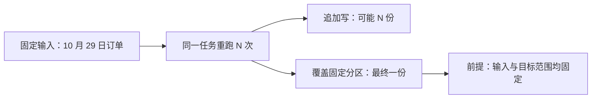
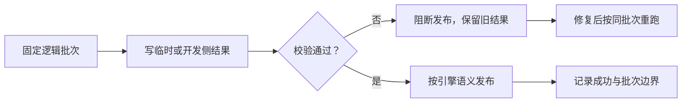

# M7：ETL 幂等与 Airflow——失败以后能不能安全重来

> ETL 指抽取（Extract）、转换（Transform）、加载（Load）：把源数据取出、按规则处理，再写入目标。订单经过转换，最终要发布到明细表或汇总表。真正困难的不是“成功跑一次”，而是中途失败、上游迟到、任务补跑以后，结果仍正确且读者不看到半截数据。
>
> 对应原理：**同一批重跑结果不变**、**计算完成与对外发布分开**、**按逻辑批次而不是当前时间补数**。

## 1. 幂等先问“同样什么，重复什么”

幂等是同一批输入、同一目标范围，执行一次或多次，最终业务结果相同。它不是“脚本不报错”，也不是“表里没有重复行”这么简单：还要考虑中间状态是否可见、其他写入方是否被误删、删旧数据失败后会怎样。

追加写 `INSERT INTO` 每重跑一次就再插一次；若没有唯一键去重或批次账本，结果会重复。覆盖写 `INSERT OVERWRITE` 替换目标分区，所以对**同一份固定输入、同一个目标分区**重跑，最终结果通常一致。若输入随 `now()` 改变、分区参数每次不同，或目标还有其他写入方，就不能套用“天然幂等”。

## 2. 结果幂等，不等于发布过程安全

原子发布是读者要么看到旧整批、要么看到新整批，不看到切换中的半批。**分区覆盖写不等于原子发布**。某些实现会先删旧分区，再逐批写新文件；读者可能看到旧数据已被删、新数据尚未写完的空窗。任务中途失败时，也可能留下空分区或部分结果。即使最终重跑能修好，在线读者当时看到的仍然是坏数据。

较稳妥的形状是：固定输入 → 写临时表或开发侧 → 数据质量校验（DQC）→ 发布 → 记录批次。临时结果失败只影响本次构建，不碰在线数据。发布前至少检查：行数相对同星期或约定基线是否异常；按业务粒度定义的主键是否唯一；在相同过滤条件、时间窗口和口径下，上下游行数、金额是否能对上。强规则是判断明确且后果严重的条件，失败应阻断发布，例如约定唯一的订单号重复、无法解释的重大金额差异。

`rename`、`REPLACE PARTITION`、交换分区是否原子，取决于具体数据库、表格式、存储和元数据系统，不能望文生义。即使发布动作原子，发布前的计算和校验也不自动原子。

空值率、枚举值检查：复习 [M3-05](../../../../../docs/notes/m3-05-quality.md) 那里的第 2 节；弱规则只告警：复习那里的第 3 节。

## 3. 删旧数据也是幂等流程的一部分

有些表没有合适的整分区替换，只能“写新一代，再删旧一代”。范围必须包括本写入方、业务分区和旧版本边界，不能整表或整分区误伤别人。更安全的顺序常是先插新代，确认质量校验通过，再删旧代。**未经确认的空批默认阻断；只有与源端按同一范围对账、确认符合业务契约的合法空批，才允许发布空结果并清理旧代**。否则，既可能把漏数当成正常清空，也可能让本应消失的旧数据永久残留。

崩溃点要逐个问：插入前失败，旧数据仍在；插入后删除前失败，新旧暂时共存，读取侧必须能按版本取新；删除执行了但结果未确认，重跑会不会把新代也删掉？因此**幂等范围应包括“删旧数据”**，不能只保护 INSERT。删除边界、版本时间精度和重试语义需要一起设计。

## 4. 晚到数据、回看窗口与补数

T+1 表示业务日期 T 的数据在次日处理或交付，并不保证所有记录都在第二天开始前到齐。网络重试、源端延迟、时区与更新时间精度都会造成晚到数据。增量任务通常设置回看窗口，例如每天处理“截止时间前最近一段”，让相邻批次有重叠，再靠目标端幂等去重。窗口要覆盖约定延迟，但不能保证无限晚到的数据；越长，读取和写入成本越高。

补数必须使用明确的逻辑日期、分区或事件边界，重放相同输入并走同样的校验与发布流程。Airflow 是安排任务依赖、重试和补跑的调度器；Task 就是一项待执行任务。它应可安全重试，读写固定分区，不用执行时的 `now()` 隐式决定业务批次。DAG 是有向无环图，在这里用节点表示任务、箭头表示先后依赖；顶层 DAG 代码也不应做网络请求或重计算。[Airflow 官方最佳实践](https://airflow.apache.org/docs/apache-airflow/stable/best-practices.html) 强调这些约束，业务幂等仍要由任务和目标表共同保证。

## 5. 已经发布了错误结果，怎样回滚

发布前阻断救不了已经上线的错批。发布时就应保留上一版可用数据或可恢复的快照，并记录输入边界、代码版本、校验结果和批次号。发现错误后，先控制受影响批次继续发布与向下游扩散，再将目标范围切回已验证的上一版；恢复动作也要核对行数、金额及读者可见性。回滚时必须协调同一范围的写入，避免覆盖错误批次之后的合法更新。

若没有旧版本，只能用可追溯的输入和修正逻辑重新构建、校验后发布，不能把“再跑一次”当成已经回滚。下游若已生成报表、汇总或缓存，恢复上游不会自动撤销这些结果，需按受影响范围重算或执行补偿，并保留错误批次与恢复记录。

## 读原文

先画一遍“写一半失败”的时间线，再读原文。记录章节和版本，区分官方直接语义与自己的故障推断；单段卡住 10 分钟就停。

| 资料与小节 | 带着什么问题读 | 用时 |
|---|---|---:|
| [Airflow Best Practices](https://airflow.apache.org/docs/apache-airflow/stable/best-practices.html)：Creating a task、Communication | 为什么 Task 要像事务？为什么不能依赖“最新数据”和 `now()`？ | 20 分钟 |
| [Hive LanguageManual DML](https://cwiki.apache.org/confluence/display/Hive/LanguageManual+DML)：Inserting data into Hive Tables from queries | OVERWRITE 与 INTO 分别改变什么？结果幂等是否证明发布原子？ | 15 分钟 |
| [Great Expectations：Define Expectations](https://docs.greatexpectations.io/docs/core/define_expectations/)：Expectation 与 Suite | 哪条断言应在发布前阻断，而非只发告警？ | 15 分钟 |

## 口述追问

1. 按分区覆盖写已经幂等，为什么读者仍可能看到空表？
2. 先删旧代再插新代，与先插新代再删旧代，故障结果有什么不同？
3. 昨天任务成功后，今天源端又补到昨天三条记录，怎样补数？
4. 目标新批次为零行，但源端也声称今天没有订单，为什么还不能直接删旧代？确认哪些条件后才可发布？
5. 错误批次发布后，下游已做汇总，同一分区又收到合法更新；为什么不能直接用旧分区覆盖回滚？怎样恢复且保住后来的更新？
